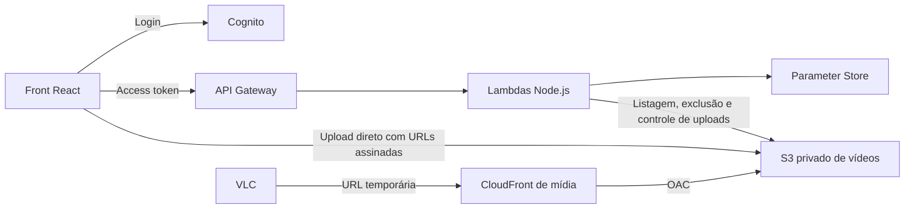

# Acervo — streaming pessoal de vídeos

Aplicação web para enviar vídeos a um bucket S3 privado, encontrar arquivos pelo nome e gerar links temporários para assistir no VLC.

O projeto é um monorepo com **React no front**, **Lambdas Node.js no back** e **Terraform para a infraestrutura AWS**. O endereço configurado para o app é **https://streaming.lucas-tavares.com**; ele passa a funcionar depois do provisionamento e da publicação do front.

## Funcionalidades

- Login por OTP de email na própria página, exclusivo do proprietário, sem cadastro público.
- Lista simples com busca por parte do nome em toda a biblioteca.
- Upload de múltiplos arquivos com progresso, cancelamento e repetição de partes com falha.
- Cada vídeo armazenado em uma pasta UUID, junto das legendas e do manifesto de faixas.
- Exibição do tempo restante até o fim da retenção de **30 dias**.
- Links HTTPS assinados pelo CloudFront, válidos por até **4 horas**, para abrir no VLC.

Os vídeos são entregues no formato original, com player no navegador e links para VLC. Não há transcodificação de áudio/vídeo ou geração de HLS/DASH. Uma Lambda Python com Layer FFmpeg/FFprobe extrai as legendas após o upload, sem alterar o vídeo; veja [legendas e organização do bucket](docs/subtitles.md).

## Como funciona



O backend autoriza e coordena as operações. Os bytes dos vídeos vão diretamente do navegador ao S3 no upload e do CloudFront ao VLC na reprodução, sem passar pelas Lambdas.

## Estrutura

```text
front/                 Interface React e componentes shadcn/ui
back/                  Código das Lambdas e contratos da API
infra/                 Recursos AWS declarados em Terraform
config/                Validação de ambiente compartilhada
scripts/               Carregamento de .env e configuração de deploy
docs/                 Documentação complementar
```

### Front

O workspace `front/` usa React, TypeScript, Vite, Tailwind CSS e componentes shadcn/ui locais.

A tela da biblioteca reúne busca, envio de arquivos, tamanho, data, prazo de expiração e ação para copiar o link. A busca continua nas páginas seguintes do S3; ela não fica limitada aos arquivos já carregados na tela.

| Arquivo/diretório              | Responsabilidade                                                                                |
| ------------------------------ | ----------------------------------------------------------------------------------------------- |
| `front/src/App.tsx`            | Entrada da aplicação                                                                            |
| `front/src/routes.tsx`         | Rotas da biblioteca e do player, com acesso condicionado à sessão                               |
| `front/src/views/`             | Telas Login, Library e Player                                                                   |
| `front/src/providers/auth.tsx` | Sessão, expiração, logout e limpeza do cache                                                    |
| `front/src/services/`          | Cliente Axios autenticado e métodos por endpoint: files, uploads, stream-links e download-links |
| `front/src/server-state/`      | QueryClient, queries e mutations do TanStack Query                                              |
| `front/src/lib/auth.ts`        | Cliente Cognito EMAIL_OTP                                                                       |
| `front/src/lib/upload.ts`      | Transferência multipart diretamente ao S3                                                       |
| `front/src/components/ui/`     | Componentes shadcn/ui                                                                           |
| `front/src/index.css`          | Tema e estilos Tailwind                                                                         |

As views usam os hooks de `server-state`, que chamam os métodos de `services`. A listagem usa paginação por cursor com `useInfiniteQuery`; renovar e excluir arquivos atualiza a listagem. O envio multipart mantém progresso e retomada no `UploadJob`, executado por uma mutation.

O login usa `USER_AUTH` com `EMAIL_OTP` na própria página, sem senha ou redirecionamento. A validade dos tokens é controlada pelo Cognito: o app client configura access tokens de 15 minutos e refresh tokens de 1 dia. Access token, refresh token e vencimentos são persistidos no `localStorage`, em uma chave específica da região e do app client Cognito. O front calcula o vencimento com `ExpiresIn`, retornado pelo Cognito em cada autenticação/refresh, e renova os tokens ao abrir/recarregar a aplicação, ao expirar e após uma resposta 401. Requisições simultâneas compartilham a renovação em andamento; cada requisição com 401 é repetida no máximo uma vez. Não há limite de duração fixo no front: a sessão pode ser renovada enquanto o Cognito aceitar o refresh token. Falhas temporárias de conexão preservam a sessão para uma nova tentativa; refresh token expirado/revogado ou um segundo 401 retornam ao login. Logout remove a sessão persistida e revoga o refresh token. O desafio OTP fica somente em memória. Sessões salvas pela versão anterior, sem refresh token, exigem novo login.

### Back

O workspace `back/` usa TypeScript, Node.js 22, AWS SDK v3 e Zod. O Vite gera `back/dist/handler.cjs`, empacotado pelo Terraform para as Lambdas.

Todas as rotas exigem um access token válido do Cognito, associação ao grupo `owners`.

| Método   | Rota                | Função                                    |
| -------- | ------------------- | ----------------------------------------- |
| `GET`    | `/files?q=&cursor=` | Listar e buscar arquivos com paginação    |
| `DELETE` | `/files`            | Excluir um arquivo                        |
| `POST`   | `/uploads`          | Iniciar uma sessão de upload multipart    |
| `POST`   | `/uploads/parts`    | Gerar URLs temporárias para enviar partes |
| `POST`   | `/uploads/complete` | Validar as partes e concluir o upload     |
| `POST`   | `/uploads/abort`    | Cancelar um upload                        |
| `POST`   | `/stream-links`     | Gerar um link assinado de streaming       |

`handler.ts` trata HTTP e autorização, `service.ts` implementa as operações, `aws.ts` integra os serviços AWS e `contracts.ts` define os contratos. Cada operação é implantada em uma Lambda com suas próprias permissões IAM. A exclusão usa `DELETE /files`, com uma Lambda dedicada e permissão `s3:DeleteObject` apenas no bucket de mídia. O botão Excluir pede confirmação antes de remover o arquivo.

O backend executa na AWS; não existe um servidor HTTP local para ele. O arquivo `back/.env.example` documenta o runtime e permite validar a configuração, mas não inicia a API.

O contrato completo está em [docs/api.md](docs/api.md).

### Infraestrutura

O diretório `infra/` provisiona:

| Recurso                | Papel                                                            |
| ---------------------- | ---------------------------------------------------------------- |
| S3 de mídia            | Armazenamento privado e criptografia dos vídeos                  |
| S3 do front            | Armazenamento privado dos arquivos estáticos do build            |
| CloudFront do front    | Entrega da aplicação, HTTPS e fallback da SPA                    |
| CloudFront de mídia    | Entrega privada com URLs assinadas e suporte a requisições Range |
| Cognito                | Login do proprietário e grupo `owners`                           |
| DynamoDB + EventBridge | Prazos renováveis e agendamento da limpeza de vídeos             |
| API Gateway + Lambda   | Operações autenticadas da biblioteca                             |
| Parameter Store        | Chave privada de assinatura e segredo dos tickets de upload      |
| IAM + CloudWatch       | Permissões por operação e logs com retenção de 14 dias           |
| Route 53 + ACM         | Subdomínio do front e certificado HTTPS                          |

A região padrão da aplicação é `sa-east-1`. O certificado do CloudFront é criado em `us-east-1`. A zona pública `lucas-tavares.com` deve existir na conta; o Terraform cria os registros A/AAAA de `streaming.lucas-tavares.com` e a validação DNS de um certificado dedicado ao app.

O certificado e os registros do portfolio permanecem sob responsabilidade daquele projeto. A distribuição privada de vídeos continua usando seu próprio domínio CloudFront.

## Executar localmente

Pré-requisitos:

- Node.js **22.16+** e npm **10+**.
- Terraform **1.11+** para trabalhar com infraestrutura.
- AWS CLI v2 e OpenSSL para realizar o deploy.

Na raiz do monorepo:

```sh
npm ci
npm run dev
```

Abra **http://localhost:5173**. Sem configuração AWS, a aplicação mostra a tela de entrada com o ambiente pendente. Para usar login, upload e listagem, conecte o front a um ambiente já implantado.

```sh
cp front/.env.example front/.env.local
```

Preencha os três valores públicos:

```dotenv
VITE_API_URL=https://<api-id>.execute-api.sa-east-1.amazonaws.com
VITE_CLIENT_ID=<client-id>
VITE_AWS_REGION=sa-east-1
```

Depois, valide e inicie o front:

```sh
npm run env:check -- --target front --file front/.env.local
npm run dev
```

Esses valores vêm do output Terraform `frontend_config`. Após o primeiro deploy, o script `scripts/write-front-env.mjs` pode gerar o arquivo automaticamente. Alterações no ambiente exigem reiniciar o Vite; em produção, exigem novo build e publicação.

## Variáveis de ambiente

| Exemplo               | Arquivo local      | Finalidade                                        |
| --------------------- | ------------------ | ------------------------------------------------- |
| `front/.env.example`  | `front/.env.local` | Valores públicos usados pelo Vite                 |
| `back/.env.example`   | `back/.env.local`  | Referência e validação do runtime Lambda          |
| `.env.deploy.example` | `.env.deploy`      | Perfil AWS, inputs Terraform e dados operacionais |

Os arquivos reais são ignorados pelo Git. Credenciais AWS, valores de segredos e chaves privadas não pertencem às variáveis `VITE_*`, pois essas variáveis são incorporadas ao código enviado ao navegador.

O inventário completo, os defaults e a precedência estão em [docs/environment.md](docs/environment.md).

## Primeiro deploy

Todos os comandos desta seção partem da raiz do projeto. O fluxo é manual: configurar ambiente, inicializar o state, aplicar a infraestrutura, inserir segredos, criar o proprietário e publicar o front.

### 1. Autenticar na AWS e instalar dependências

Para o perfil SSO usado neste projeto:

```sh
aws sso login --profile lucas-personal
aws --profile lucas-personal sts get-caller-identity
npm ci
```

Se usar outro perfil ou uma role, ajuste a configuração correspondente em `.env.deploy`. A identidade precisa das permissões de infraestrutura, incluindo Route 53 na zona existente e ACM em `us-east-1`.

### 2. Gerar as chaves de assinatura

Crie o par RSA fora do repositório:

```sh
umask 077
ACERVO_KEYS_DIR="$HOME/.config/acervo/keys"
mkdir -p "$ACERVO_KEYS_DIR"
openssl genrsa -out "$ACERVO_KEYS_DIR/cloudfront-private.pem" 2048
openssl rsa -in "$ACERVO_KEYS_DIR/cloudfront-private.pem" -pubout -out "$ACERVO_KEYS_DIR/cloudfront-public.pem"
```

A chave pública será fornecida ao Terraform. A privada será inserida diretamente no Parameter Store, sem passar pelo state.

### 3. Preencher o ambiente de deploy

```sh
cp .env.deploy.example .env.deploy
```

Edite o arquivo e substitua os placeholders:

| Variável                          | O que preencher                                                      |
| --------------------------------- | -------------------------------------------------------------------- |
| `AWS_PROFILE`                     | Perfil AWS; padrão do exemplo: `lucas-personal`                      |
| `AWS_REGION` / `TF_VAR_region`    | Mesma região da aplicação; padrão `sa-east-1`                        |
| `TF_VAR_name`                     | Nome dos recursos, de 3 a 30 caracteres minúsculos, números e hífens |
| `TF_VAR_signing_public_key_path`  | Caminho absoluto de `cloudfront-public.pem`                          |
| `TF_VAR_hosted_zone_name`         | Zona existente; padrão `lucas-tavares.com`                           |
| `TF_VAR_frontend_domain_name`     | Subdomínio; padrão `streaming.lucas-tavares.com`                     |
| `ACERVO_OWNER_EMAIL`              | Email do proprietário que receberá o convite Cognito                 |
| `ACERVO_SIGNING_PRIVATE_KEY_PATH` | Caminho absoluto de `cloudfront-private.pem`                         |

Mantenha os demais defaults ou consulte o guia de ambiente. Use caminhos absolutos reais: o launcher não expande `$HOME` ou outras referências dentro do `.env`. Não mantenha inputs divergentes em `TF_VAR_*` e arquivos `.tfvars`.

### 4. Carregar o ambiente em uma sessão de shell

Abra uma sessão Bash com o arquivo carregado:

```sh
node scripts/with-env.mjs .env.deploy bash --noprofile --norc
```

**Execute os próximos comandos dentro dessa sessão.** Ela herda as variáveis do arquivo sem avaliar seu conteúdo como código. Valores já exportados no processo têm prioridade sobre o arquivo.

```sh
npm run env:check -- --target deploy
```

O launcher não inicia nenhuma operação de deploy sozinho. Se preferir executar comandos isolados, use `node scripts/with-env.mjs .env.deploy <comando> [argumentos]`, como detalhado no [guia de implantação](docs/deployment.md).

### 5. Inicializar o Terraform com state local

```sh
terraform -chdir=infra init
```

O projeto usa o backend local padrão. Depois do apply, o estado fica em `infra/terraform.tfstate`, com backup em `infra/terraform.tfstate.backup`. Esses arquivos são ignorados pelo Git. Preserve uma cópia segura do state para continuar gerenciando os recursos a partir de outra máquina ou recuperar seu ambiente.

O deploy é manual, executado nesta máquina; não exige bucket de state nem pipeline.

### 6. Compilar e aplicar a infraestrutura

O build do backend precisa existir antes do plano, pois o Terraform empacota `back/dist/handler.cjs`.

```sh
npm run check
npm run infra:check
terraform -chdir=infra plan -out=production.tfplan
```

Revise o plano e confirme a conta/região de destino. Para criar os recursos:

```sh
terraform -chdir=infra apply production.tfplan
```

O apply cria recursos AWS sujeitos a cobrança. Aguarde a emissão do certificado e a propagação de DNS/CloudFront. O Terraform configura o domínio, o login OTP do Cognito e o CORS.

### 7. Inserir os segredos — somente no primeiro setup

```sh
npm run env:check -- --target deploy --stage secrets
node --experimental-strip-types scripts/init-secrets.mjs
```

O script lê a chave privada de `ACERVO_SIGNING_PRIVATE_KEY_PATH`, obtém os ARNs pelos outputs e grava a chave e um segredo HMAC como `SecureString` no Parameter Store, no nível `Standard`, com a chave KMS gerenciada `alias/aws/ssm`. Valores já inicializados são preservados.

O script preenche apenas os marcadores do primeiro setup e preserva valores existentes quando executado novamente. Trocar o segredo HMAC manualmente invalida tickets de upload e cursores ainda ativos. A rotação de chaves está descrita no [guia de operação](docs/deployment.md#rotação-de-chaves).

### 8. Criar o proprietário — somente no primeiro setup

```sh
npm run env:check -- --target deploy --stage owner
ACERVO_POOL_ID=$(terraform -chdir=infra output -raw user_pool_id)

aws cognito-idp admin-create-user \
  --user-pool-id "$ACERVO_POOL_ID" \
  --username "$ACERVO_OWNER_EMAIL" \
  --user-attributes "Name=email,Value=$ACERVO_OWNER_EMAIL" Name=email_verified,Value=true \
  --message-action SUPPRESS

aws cognito-idp admin-add-user-to-group \
  --user-pool-id "$ACERVO_POOL_ID" \
  --username "$ACERVO_OWNER_EMAIL" \
  --group-name owners
```

Com EMAIL_OTP já habilitado pelo apply, o usuário é criado sem senha temporária e sem convite. O código será enviado quando ele informar o email no próprio app. Se o usuário já existir, não repita a criação: confirme seu status, email verificado e associação ao grupo `owners`. Usuários antigos em `FORCE_CHANGE_PASSWORD` precisam ter a configuração ajustada administrativamente antes do acesso OTP.

### 9. Publicar o front

Gere a configuração pública a partir dos recursos provisionados e faça um novo build:

```sh
node --experimental-strip-types scripts/write-front-env.mjs
npm run env:check -- --target front --file front/.env.local
npm run build

ACERVO_FRONT_BUCKET=$(terraform -chdir=infra output -raw frontend_bucket)
ACERVO_FRONT_DISTRIBUTION=$(terraform -chdir=infra output -raw front_distribution_id)

aws s3 sync front/dist/ "s3://$ACERVO_FRONT_BUCKET/" \
  --exclude index.html --cache-control 'public,max-age=31536000,immutable'

aws s3 cp front/dist/index.html "s3://$ACERVO_FRONT_BUCKET/index.html" \
  --cache-control 'no-cache,no-store,must-revalidate' --content-type text/html

aws cloudfront create-invalidation \
  --distribution-id "$ACERVO_FRONT_DISTRIBUTION" --paths /index.html / /callback

terraform -chdir=infra output -raw frontend_url
```

Acesse a URL exibida, entre com o proprietário e envie um vídeo. Ao terminar, use `exit` para sair da sessão Bash de deploy.

## Deploys seguintes

Com `.env.deploy` preenchido na raiz e dependências instaladas:

```sh
npm run deploy
```

Executa `deploy:back` (build do backend, Terraform e inicialização dos segredos pendentes) e depois `deploy:front` (configuração pública, build, envio ao S3 e invalidação do CloudFront). Uma falha interrompe a sequência. O Terraform aplica com `-auto-approve`, sem confirmação interativa. Os scripts carregam `.env.deploy` automaticamente; variáveis já exportadas têm prioridade. No primeiro deploy, `ACERVO_SIGNING_PRIVATE_KEY_PATH` é necessário para inicializar os `SecureString`; segredos existentes são preservados e dispensam o arquivo privado nos deploys seguintes.

Para executar só uma etapa, use `npm run deploy:back` ou `npm run deploy:front`. Para revisar o plano antes do apply, siga o fluxo manual acima. Se ainda estiver migrando do Secrets Manager, siga primeiro a [migração documentada](docs/deployment.md#migração-de-um-deploy-com-secrets-manager).

Não repita a criação do proprietário ou a inicialização dos segredos. Preserve os builds publicados para rollback; o [guia de operação](docs/deployment.md) explica como restaurar uma versão preservando os dados.

## Upload, retenção e VLC

O botão **Assistir** abre `/watch/:fileName` com o player nativo do navegador, controles de reprodução e tela cheia. A rota usa o nome completo do objeto (UUID e nome original) e exige login; links diretos preservam o destino após autenticar. Formatos e codecs dependem do navegador, sem transcodificação. A navegação mantém uploads em andamento.

Os uploads aceitam apenas vídeos, com validação de extensão e MIME compartilhada entre front e backend. MP4, WebM, MOV, MKV e outros formatos estão listados no [contrato da API](docs/api.md).

O limite padrão por arquivo é **20 GiB**, ajustável para baixo por `TF_VAR_max_upload_bytes`. Os uploads usam partes de **16 MiB**, até três partes simultâneas por arquivo e URLs de partes válidas por 15 minutos. A sessão dura até 24 horas; fechar a página perde a retomada local. Partes abandonadas são removidas pelo Lifecycle.

Cada chave de vídeo tem o formato `<uuid>/<nome-original>`. A mesma pasta guarda `tracks.json` e os arquivos SRT/WebVTT extraídos. Nomes repetidos permanecem como vídeos diferentes. A biblioteca lista apenas os vídeos; excluir um vídeo remove a pasta daquele UUID. O player carrega o manifesto e a faixa selecionada por rotas GET autenticadas, sem extração no navegador.

O prazo inicial de 30 dias usa `LastModified` do S3; em multipart, esse marco corresponde ao início do upload. **Reiniciar prazo** define um novo vencimento para 30 dias a partir de agora, sem copiar o vídeo nem mudar a data original de envio. As renovações são registradas no DynamoDB. A aplicação encerra novos acessos ao fim do prazo, e uma Lambda acionada a cada hora remove os vídeos expirados. O Lifecycle do S3 remove apenas partes de uploads abandonados. Um vídeo expirado ainda presente pode ser renovado enquanto sua exclusão não tiver começado.

**Baixar** gera um link temporário de até 15 minutos e inicia o download direto do S3, mantendo o nome original. O prazo desse link também respeita o vencimento do vídeo.

Um link vence em `min(agora + 4 horas, fim da retenção)`. Quem receber a URL pode acessar o vídeo até esse vencimento. Para assistir:

1. Clique em **Copiar link** na biblioteca.
2. No VLC, abra **Mídia → Abrir fluxo de rede**.
3. Cole a URL completa e inicie a reprodução.

Novas requisições de trechos após o vencimento são negadas; uma transferência HTTP já iniciada pode continuar. Se ainda houver retenção disponível, gere outro link no app.

## Atualizar um ambiente existente para OTP

O login por email/código depende de aplicar as mudanças de `sign_in_policy` e `explicit_auth_flows` do Cognito. O API Gateway continua verificando JWT; as Lambdas continuam exigindo `token_use=access` e grupo `owners`. O scope OAuth customizado não é exigido no fluxo nativo OTP.

Na sessão com `.env.deploy` carregado:

```sh
npm run check
terraform -chdir=infra plan -out=otp.tfplan
terraform -chdir=infra apply otp.tfplan
node --experimental-strip-types scripts/write-front-env.mjs
npm run build
```

Depois, publique o front conforme a etapa 9. O novo output usa `VITE_API_URL`, `VITE_CLIENT_ID` e `VITE_AWS_REGION`; não usa domínio Cognito nem scope OAuth no browser. Sem o apply e a publicação, o ambiente remoto continua no fluxo anterior.

## Comandos úteis

| Comando                                                        | Finalidade                                         |
| -------------------------------------------------------------- | -------------------------------------------------- |
| `npm run dev`                                                  | Iniciar o front local                              |
| `npm run build`                                                | Gerar os builds do front e backend                 |
| `npm run typecheck`                                            | Verificar tipos TypeScript                         |
| `npm run lint`                                                 | Executar ESLint                                    |
| `npm run format`                                               | Aplicar Prettier e ordenar classes Tailwind        |
| `npm run format:check`                                         | Verificar formatação sem escrever                  |
| `npm run check`                                                | Verificar formatação, tipos, lint e build          |
| `npm run infra:check`                                          | Verificar formatação e validar Terraform após init |
| `npm run env:check -- --target front --file front/.env.local`  | Validar ambiente público do front                  |
| `npm run env:check -- --target backend --file back/.env.local` | Validar a configuração de uma operação Lambda      |
| `npm run env:check -- --target deploy --file .env.deploy`      | Validar inputs de infraestrutura sem acessar AWS   |

## Documentação complementar

- [Variáveis de ambiente](docs/environment.md): campos, defaults, origem e precedência.
- [Implantação e operação](docs/deployment.md): comandos isolados, permissões, rotação de chaves, custos e rollback.
- [API](docs/api.md): payloads, respostas, paginação e erros.
